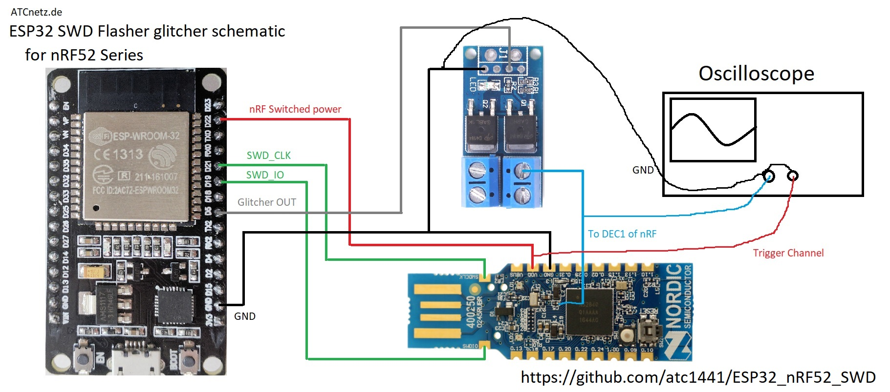
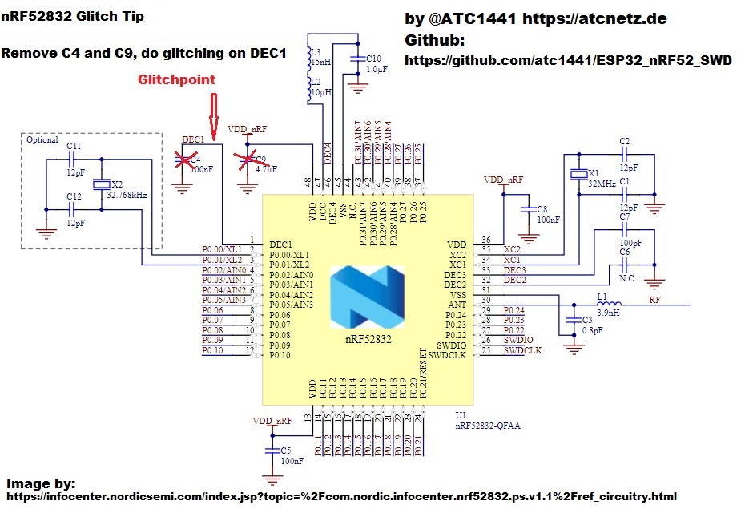

# ESP32 SWD Flasher for nRF52
This software makes it possible to Read and Write the internal Flash of the Nordic nRF52 series with an ESP32 using the SWD interface.
A tool to exploit the APPROTECT vulnerability is included as well.

### You can support my work via PayPal: https://paypal.me/hoverboard1 this keeps projects like this coming.

To flash an nRF52 connect the following:
- nRF52 **SWDCLK** to ESP32 **GPIO 21**
- nRF52 **SWDIO** to ESP32 **GPIO 19**
- nRF52 **GND** to ESP32 **GND** to N-Channel MOSFET **GND** (Optional: O-scope **GND Clips**)
- Then power the nRF52 as needed

To bypass the Readout protection (APPROTECT) of an nRF52 connect all of the above and the following:
- nRF52 3.3V Power **VDD** to ESP32 **GPIO 22** (Optional: O-scope **Channel 2 Probe**)
- N-Channel MOSFET **PWM+** to ESP32 **GPIO 5** (as shown)
- N-Channel MOSFET **VOUT-** to nRF52 **DEC1** (as shown) (Optional: O-scope **Channel 1 Probe**)
- Then power the nRF52 as needed


This repo is explained and demonstrated in these videos (click to watch):


[](https://www.youtube.com/watch?v=tMPD0kBG_So)


[](https://www.youtube.com/watch?v=Iu6RoXRZxOk)

### Required Hardware

- ESP32 Development Board
- nRF52 Series Board
- Optional for circumventing APPROTECT:
  - Oscilloscope
  - N-Channel MOSFET (Board)

### Common setup steps

Change the WiFi credentials in `src/web.cpp` and the pinout to your needs in the `platformio.ini` file

### Option 1: Visual Studio Code: Build/upload steps

Use Visual Studio Code with PlatformIO to compile and upload the project.

Note: The Arduino IDE is not supported any more!

Upload the data/index.htm to the ESP32 via the http://swd.local/edit web editor

### Option 2: CLI build/upload steps

No need to install VS Code/Codium if all you want is a flashed ESP32

#### Compile
Look into `platformio.ini` what your device needs or probably add a new block for your specific hardware there

E.g., for the ESP32 Devkit, run:

`pio run -e ESP32_nRF52_SWD`

#### Build the SPIFFS flash image
The resulting `spiffs.bin` contains the contents of `data/`. No upload of `index.htm` necessary (as mentioned in the VS Code route above) when it gets flashed as well (see below)

`pio run -t buildfs`

#### Flash the ESP32
```
port=/dev/ttyUSB0 # change to whatever becomes available if you connect the ESP with the BOOT button/pin held down
esptool --port $port erase-flash
esptool --port $port --chip esp32 --baud 921600 --before default-reset --after hard-reset write-flash -z --flash-mode dout --flash-size detect 0x1000 .pio/build/ESP32_nRF52_SWD/bootloader.bin 0x8000 .pio/build/ESP32_nRF52_SWD/partitions.bin 0x10000 .pio/build/ESP32_nRF52_SWD/firmware.bin 0x120000 .pio/build/ESP32_nRF52_SWD/spiffs.bin
```

#### (optional) use a serial terminal to see debug messages
```
minicom -D $port
```

### Usage

Point your browser at http://swd.local

There is also a web editor page at http://swd.local/edit where you can e.g. upload firmware files you can reference on the main page (default login is `admin/admin` or the credentials you changed it to in `src/web.cpp` above).

The web editor needs a working internet connection for downloading JS client components.

### ESP32 Glitcher schematic:



#### nRF52832 Glitch Tip, way better results with these 2 caps removed



Credits go to LimitedResults for finding the Power glitching Exploit: https://limitedresults.com/2020/06/nrf52-debug-resurrection-approtect-bypass-part-2/
